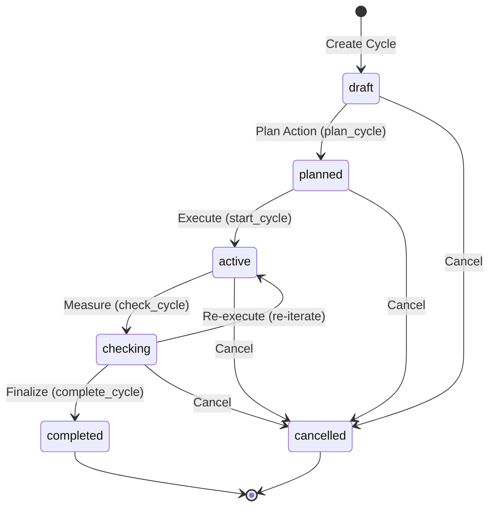

# UyAI — Kaizen / PDCA Intelligence System & Admin Property Creation (Phase 12)

## 1. Executive Summary

Phase 12 implements the continuous operational improvement system (**Kaizen / PDCA**) and **unified property creation from the Admin Panel** for UyAI.
It provides real-time, zero-hallucination metric calculations, structured Plan-Do-Check-Act improvement lifecycles, non-autonomous AI recommendations, and full lifecycle property ingestion ensuring a single source of truth across Telegram Bot, Mini App, and Admin Panel.

---

## 2. Core Architectural Principles

1. **Non-Autonomous AI Policy (Human in the Loop)**:
   - Recommendations are advisory only.
   - The AI or system cannot autonomously fire brokers, alter permissions, block users, change system configs, or publish/reject listings without explicit staff approval.
2. **Deterministic Metric Calculations (Zero Fabrication)**:
   - All metrics (conversion rates, response time percentiles, viewing completion rates, CRM failure counts) are calculated directly from PostgreSQL via SQLAlchemy.
   - If data is absent or insufficient for statistical significance (e.g., sample size < 3), `insufficient_data` or `None` is returned — never hallucinated or assumed.
   - Division by zero is protected via `_safe_percentage`.
3. **Single Source of Truth for Properties**:
   - Properties created in the Admin Panel use the canonical `Property`, `PropertyMedia`, and `PropertyService` domain models.
   - Any approved property is instantly searchable via `PropertySearchService` across Telegram Bot, Mini App, and Admin without requiring separate tables or synchronization caches.
4. **Immutable Audit Logging**:
   - Every PDCA transition (`plan`, `start`, `check`, `complete`, `cancel`), recommendation review (`accept`, `dismiss`), media upload, and property creation writes an immutable `AdminAuditEvent` with actor ID, IP address, and metadata.

---

## 3. Deterministic KPI Engine Formulas

| Metric | Formula / Algorithm | Zero/Insufficient Data Handling |
| :--- | :--- | :--- |
| **Overall Win Rate** | $\frac{\text{won\_leads}}{\text{closed\_leads}} \times 100\%$ where $\text{closed\_leads} = \text{won} + \text{lost}$ | If $\text{closed\_leads} = 0$, falls back to $\text{total\_leads}$; if still 0, returns `None`. |
| **Stage Progression Rates** | $\frac{\text{reached\_stage\_k}}{\text{reached\_stage\_(k-1)}} \times 100\%$ | Returns `None` if denominator is 0. |
| **Response Time (p50, p90)** | Durations between lead creation and first contact (status transition or follow-up note). Percentiles computed via standard quantile interpolation. | Returns `insufficient_data = True` if sample size $< 1$. |
| **Viewing Completion Rate**| $\frac{\text{completed\_viewings}}{\text{total\_viewings}} \times 100\%$ | Returns `None` if `total_viewings == 0`. |
| **Viewing Cancellation Rate**| $\frac{\text{cancelled\_viewings}}{\text{total\_viewings}} \times 100\%$ | Returns `None` if `total_viewings == 0`. |
| **CRM Outbox Success Rate**| $\frac{\text{sent\_events}}{\text{total\_events}} \times 100\%$ | Returns `None` if `total_events == 0`. |

---

## 4. PDCA Finite State Machine

### Lifecycle States & Actions:
- **`draft`**: Baseline KPI snapshot captured automatically upon creation.
- **`planned`**: Action plan and responsibilities documented.
- **`active`**: Implementation in progress; start timestamp locked.
- **`checking`**: Mid-course or final KPI snapshot captured; delta and percentage progress towards target calculated automatically.
- **`completed`**: Standardized outcome logged (`successful`, `partially_successful`, `unsuccessful`) with Act/Standardization notes.
- **`cancelled`**: Cycle aborted with mandatory explanatory reason.

---

## 5. Security & RBAC Matrix

| Role | `properties.create` | `properties.moderate` | `kaizen.view` | `kaizen.manage` | `kaizen.generate` |
| :--- | :---: | :---: | :---: | :---: | :---: |
| **superadmin** | ✅ | ✅ | ✅ | ✅ | ✅ |
| **head_broker** | ✅ | ✅ | ✅ | ✅ | ✅ |
| **sales_broker** | ✅ | ❌ | ❌ | ❌ | ❌ |
| **rental_broker** | ✅ | ❌ | ❌ | ❌ | ❌ |
| **support** | ❌ | ❌ | ❌ | ❌ | ❌ |
| **customer** | ❌ | ❌ | ❌ | ❌ | ❌ |

- `auto_approve` flag during property creation strictly requires `properties.moderate` (`head_broker` or `superadmin`). If requested by a broker without moderation permissions, HTTP 403 Forbidden is raised.
- Mutating endpoints require `X-CSRF-Token` header matching the active session cookie.

---

## 6. Property Media Upload Security

- **Supported Formats**: JPEG, PNG, WEBP.
- **Max File Size**: 5 MB (`MAX_IMAGE_BYTES = 5 * 1024 * 1024`).
- **Deep Inspection**: Magic byte signature validation (`\xff\xd8\xff` for JPEG, `\x89PNG\r\n\x1a\n` for PNG, `RIFF...WEBP` for WEBP). Rejects mismatched extensions.
- **Path Traversal Protection**: Media filenames are sanitized with UUIDs (`admin_media_<hex>.jpg`) and checked against destination directory traversal boundaries (`os.path.abspath(MEDIA_CACHE_DIR)`).
- **Format Flexibility**: Accepts raw binary request bodies or Base64 JSON payloads.
